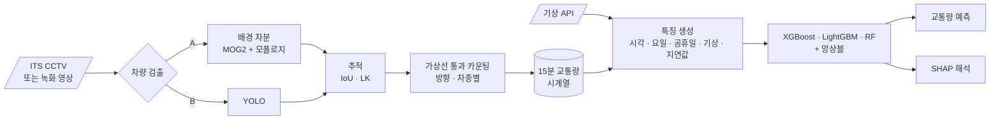

<div align="center">

# 📈 CCTV Traffic Volume Forecasting

**도로 CCTV 영상으로 교통량을 세고, 기상 · 달력 정보로 시간대별 교통량을 예측**


> 영상에서 뽑은 숫자를 정형 데이터 머신러닝의 입력으로 씁니다.<br/>
> **비전(검출 · 추적 · 카운팅)과 시계열 예측(트리 앙상블 · SHAP)을 한 파이프라인으로** 잇는 프로젝트입니다.

</div>

> [!NOTE]
> 🚧 **계획 단계입니다.** 아직 코드가 없고, 이 README는 프로젝트 설계서입니다.

---

## 📌 문제 정의

[자전거 수요 예측 프로젝트](https://github.com/cbnu-yhjeon/PROJECT-Bicyle-Demand-Forecasting)는 이미 집계된 공공 데이터로 수요를 예측했습니다. 이 프로젝트는 집계 데이터가 없는 지점에서 **CCTV 영상으로 직접 교통량 데이터를 만들고**, 그 데이터로 예측까지 합니다.

## 🎯 목표

| # | 목표 | 성공 기준 |
|:---:|---|---|
| G1 | 차량 검출 · 추적 · 가상선 통과 카운팅 (방향 · 차종별) | 수작업 카운트 대비 오차 측정 |
| G2 | 15분 단위 교통량 시계열 자동 수집 | 수 주 이상 연속 수집 |
| G3 | 기상 · 달력 특징을 합친 교통량 예측 | 계절성 기준선(지난주 같은 시각) 대비 개선 |
| G4 | SHAP으로 교통량 변화 요인 해석 | 요인별 기여도 그래프 |

---

## 🔗 기반 수업과 저장소

| 수업 / 프로젝트 | 가져올 것 | 저장소 |
|---|---|---|
| 산업 컴퓨터비전 Lec 6 · 9 · 12 | 움직임 기반 분할(배경 차분), LK 추적, HoG 검출 | [industrial_computor_vision](https://github.com/cbnu-yhjeon/industrial_computor_vision) (`Data/traffic.mp4`로 개발 가능) |
| 지능화 캡스톤 (10주차) | 딥러닝 객체 탐지 | [capston-pilot](https://github.com/cbnu-yhjeon/capston-pilot) |
| 자전거 수요 예측 | 기상 데이터 수집(Open-Meteo · 기상청), XGBoost · LightGBM · RF, 앙상블, SHAP | [PROJECT-Bicyle-Demand-Forecasting](https://github.com/cbnu-yhjeon/PROJECT-Bicyle-Demand-Forecasting) |
| 패턴인식 | 회귀 · 분류 모델 평가 | [Pattern_Rcognition](https://github.com/cbnu-yhjeon/Pattern_Rcognition) |

---

## 🧭 접근 방법



1. **영상 수집:** 국가교통정보센터(ITS) 오픈데이터의 CCTV 화상정보 API로 지점을 고릅니다. API가 스트림을 주는지 스냅샷을 주는지는 명세를 확인해야 하므로, 1주차에 수집 방식을 확정합니다. 개발 단계에서는 `traffic.mp4` 같은 녹화 영상을 씁니다.
2. **검출:** 고정 카메라라서 배경 차분(MOG2)이 잘 맞습니다. 야간 · 우천처럼 배경 차분이 흔들리는 조건에서는 YOLO와 비교합니다.
3. **카운팅:** 추적된 객체의 중심점이 가상선을 지나면 한 대로 셉니다. 같은 차를 두 번 세지 않도록 트랙 ID 단위로 한 번만 셉니다.
4. **예측:** 자전거 수요 예측의 특징 생성 · 모델 · 앙상블 · SHAP 코드를 재사용합니다.

---

## 🗂️ 데이터

| 데이터 | 용도 | 비고 |
|---|---|---|
| [ITS 국가교통정보센터 오픈데이터](https://www.its.go.kr/opendata/) | CCTV 영상 | 회원가입 후 인증키 신청 |
| [Open-Meteo](https://open-meteo.com/) · 기상청 API | 기상 특징 | 자전거 프로젝트와 같은 소스 |
| 공휴일 정보 | 달력 특징 | 공공데이터포털 특일 정보 |
| 수작업 카운트 (직접 작성) | 카운팅 정확도 검증 | 시간대 · 날씨가 다른 클립 샘플 |

---

## 🧪 실험 설계

### 카운팅

| ID | 검출 | 추적 | 확인할 것 |
|:---:|---|---|---|
| C1 | MOG2 | IoU | 고전 기준선 |
| C2 | MOG2 | IoU + LK | 가려짐 구간 보완 |
| C3 | YOLO | IoU | 야간 · 우천 강건성 |

### 예측

| ID | 모델 | 목적 |
|:---:|---|---|
| P0 | 계절성 기준선 (지난주 같은 시각) | 하한선 |
| P1 | XGBoost · LightGBM · RF (시각 · 요일 · 공휴일만) | 달력 효과 |
| P2 | P1 + 기상 | 기상 효과 |
| P3 | 앙상블 | 최종안 |

### 지표

- **카운팅:** 수작업 대비 MAPE, 방향별 · 차종별 오차, 조건(주간 · 야간 · 우천)별 오차
- **예측:** MAE, RMSE, MAPE (시간 순서를 지킨 분할로 평가)
- **해석:** SHAP 요인 기여도

---

## 🗓️ 마일스톤

| 주차 | 내용 | 산출물 |
|:---:|---|---|
| 1 | ITS API 확인, 지점 선정, 수집 방식 확정 | 수집 스크립트 |
| 2 | MOG2 · IoU 카운터 (C1) | 녹화 영상 카운팅 |
| 3 | LK 보완, YOLO 비교 (C2 · C3), 수작업 검증 | 카운팅 정확도 표 |
| 4~6 | 연속 수집 (백그라운드), 특징 파이프라인 | 15분 교통량 데이터 |
| 7 | 예측 모델 P0 ~ P3 | 예측 결과 |
| 8 | SHAP 해석, 대시보드, 정리 | 최종 보고서 |

## 📁 디렉토리 구조 (계획)

```
CCTV-Traffic-Volume-Forecasting/
├── configs/            지점별 가상선 좌표, 수집 주기
├── src/
│   ├── collect/        its_cctv.py · weather.py
│   ├── vision/         detect_mog2.py · detect_yolo.py · tracker.py · counter.py
│   ├── features/       calendar.py · lags.py
│   ├── models/         train.py · ensemble.py · shap_report.py
│   └── eval/           count_accuracy.py · forecast_metrics.py
├── data/               (집계 결과만, 원본 영상은 저장하지 않음)
├── results/
└── README.md
```

## ⚠️ 리스크와 대응

| 리스크 | 대응 |
|---|---|
| API가 스냅샷만 주거나 프레임 간격이 길면 추적 불가 | 스냅샷이면 "프레임 내 차량 수" 기반 밀도 지표로 전환 |
| CCTV 시점이 바뀌거나(PTZ) 영상이 끊김 | 시점 변화 감지(배경 유사도)로 해당 구간 제외, 결측 처리 |
| 개인정보 (번호판 · 보행자) | 원본 영상을 저장하지 않고 집계 숫자만 기록, 식별 정보는 처리하지 않음 |
| 수집 기간이 짧으면 계절성 학습이 어려움 | 요일 · 시간대 중심으로 시작, 수집이 쌓이면 재학습 |

## 📚 참고 자료

- Z. Zivkovic, *Improved Adaptive Gaussian Mixture Model for Background Subtraction* (MOG2), ICPR 2004
- A. Bewley et al., *Simple Online and Realtime Tracking* (SORT), ICIP 2016
- T. Chen, C. Guestrin, *XGBoost: A Scalable Tree Boosting System*, KDD 2016
- 자전거 수요 예측 프로젝트의 SHAP 분석 노트북
