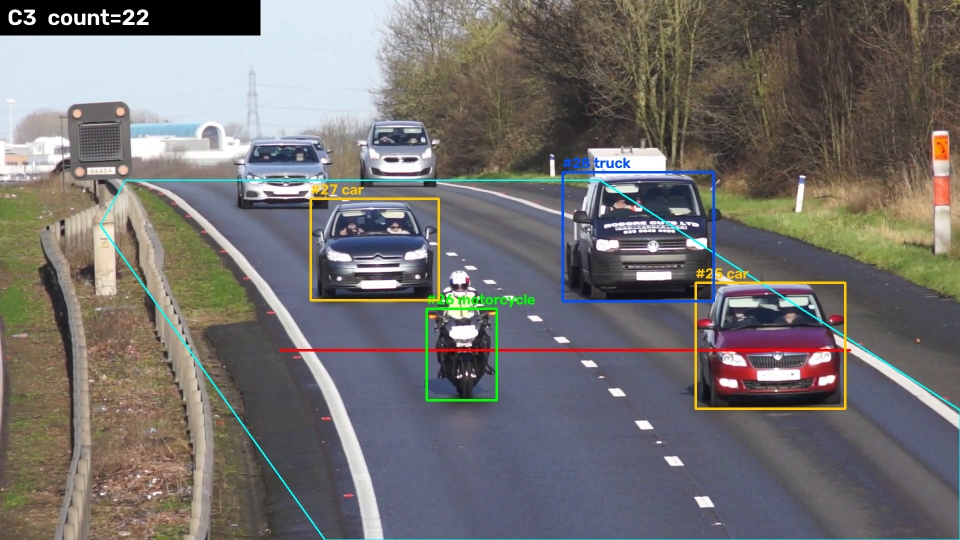
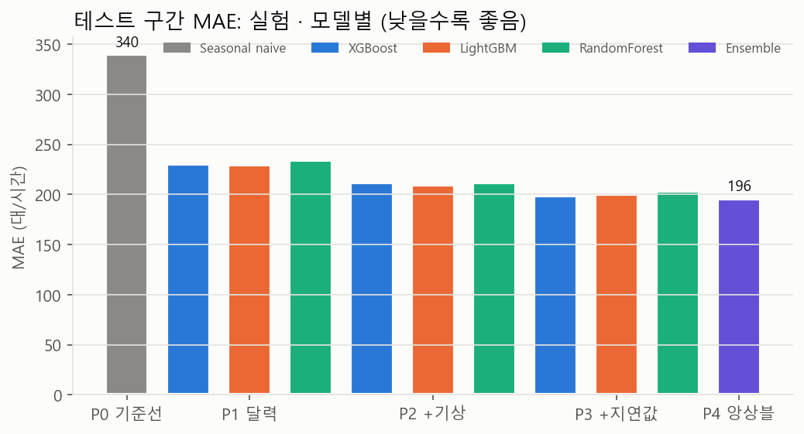
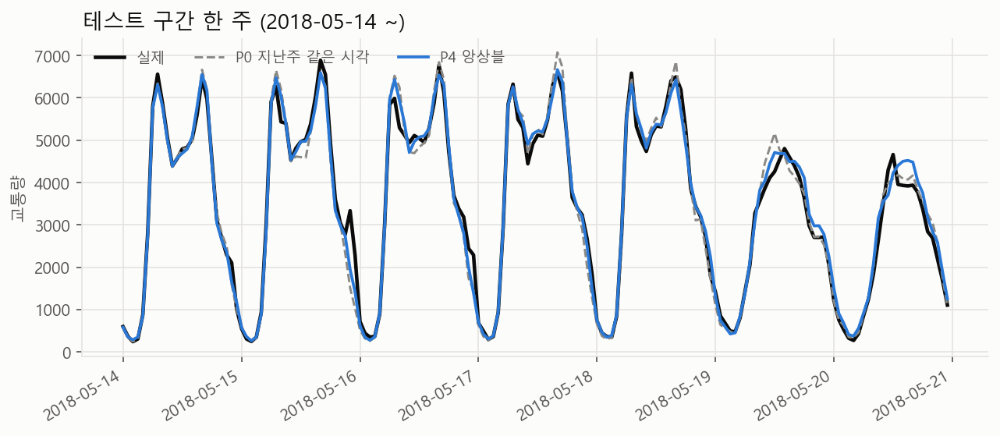
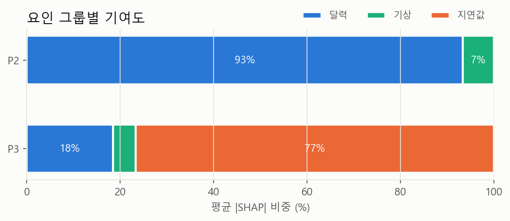
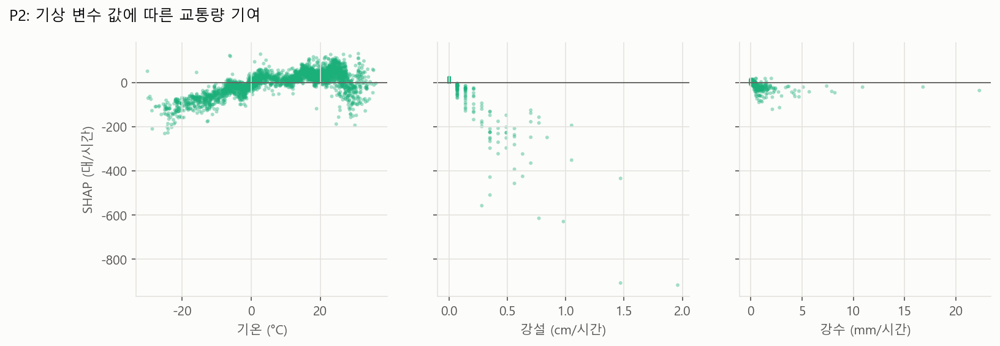
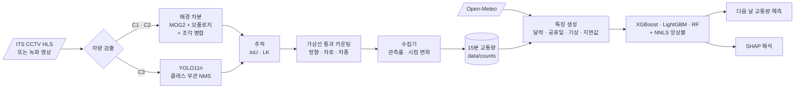

<div align="center">

# 📈 CCTV Traffic Volume Forecasting

**도로 CCTV 영상으로 교통량을 세고, 기상 · 달력 정보로 시간대별 교통량을 예측**


> 영상에서 뽑은 숫자를 정형 데이터 머신러닝의 입력으로 씁니다.<br/>
> **비전(검출 · 추적 · 카운팅)과 시계열 예측(트리 앙상블 · SHAP)을 한 파이프라인으로** 잇는 프로젝트입니다.

</div>

> [!NOTE]
> **v0.1 · 2026-10-30.** 카운팅 · 수집 · 예측 · 해석 파이프라인을 모두 구현하고 검증했습니다.
> 실제 ITS CCTV 연속 수집에는 **정식 인증키**가 필요합니다. `apiKey=test`는 CCTV 목록만 주고 스트림은 401로 막혀 있습니다.
> 그래서 예측 파이프라인은 공개 시간별 교통량 데이터(UCI Metro Interstate)로 먼저 검증했습니다. 키를 받으면 [바로 수집을 시작하는 방법](#-실시간-수집-시작하기)대로 진행하면 됩니다.

---

## 📊 결과 요약

| 목표 | 결과 | 상태 |
|---|---|:---:|
| **G1** 차량 검출 · 추적 · 가상선 카운팅 | YOLO11n + IoU 추적(C3): 60초 클립 **30대 중 30대**, 정밀도 · 재현율 1.000, 차종 그룹 정확도 0.967 | ✅ |
| **G2** 15분 교통량 자동 수집 | 수집기 구현(스트림 재연결 · URL 토큰 갱신 · 시점 변화 감지 · 관측률 기록), 녹화 영상으로 끝까지 시험 | ⏳ 정식 키 필요 |
| **G3** 기상 · 달력 특징 교통량 예측 | 대리 데이터 테스트(2018-01~09): P4 앙상블 **MAE 196대/시간**, 계절성 기준선(340) 대비 **−42.3%** | ✅ (대리 데이터) |
| **G4** SHAP 요인 해석 | 눈 오는 시간 기상 요인 **−330대/시간**, 비 −18대/시간, 영하 15°C 미만 −87대/시간 | ✅ (대리 데이터) |

### G1 · 카운팅 정확도 (`traffic.mp4`, 60초, 주간 · 맑음, 2차로 일방향)



정답은 수작업으로 셌습니다. 가상선 픽셀을 시간 축으로 쌓은 [슬릿스캔](results/counting/slitscan/)에서 차량 덩어리를 세고, 애매한 구간은 원본 프레임으로 확인했습니다([방법](data/annotations/README.md)). 평가 창은 1~60초입니다(MOG2 워밍업 1초 제외).
이벤트 매칭은 같은 차로 안에서 시각 차이 ±1초 이내인 쌍을 같은 차로 보고 짝지었습니다.

| 실험 | 검출 | 추적 | 수작업 | 예측 | 전체 오차 | 정밀도 | 재현율 | F1 | 차종 그룹 | 방향 | 처리 속도* |
|:---:|---|---|---:|---:|---:|---:|---:|---:|---:|---:|---:|
| C1 | MOG2 | IoU | 30 | 29 | 3.3% | 0.966 | 0.933 | 0.949 | 0.929 | 0.893 | 71 fps |
| C2 | MOG2 | IoU + LK | 30 | 28 | 6.7% | 0.964 | 0.900 | 0.931 | 0.926 | 0.926 | 72 fps |
| **C3** | **YOLO11n** | **IoU** | **30** | **30** | **0.0%** | **1.000** | **1.000** | **1.000** | 0.967 | **1.000** | 60 fps |

<sub>* 1920×1080 입력, RTX 5060 Ti. 다른 작업과 CPU를 나눠 쓰던 상태에서 측정했습니다.</sub>

- **MOG2의 한계는 덩어리 병합과 분할입니다.** 옆 차로를 나란히 달리는 두 대(23초, 42초)가 한 덩어리로 합쳐져 한 대씩 놓쳤습니다. 합쳐진 덩어리의 중심이 위로 튀면서 반대 방향 카운트도 생겼습니다.
- **LK 보완(C2)은 이 클립에서 효과가 없었습니다.** 두 차가 멀리서부터 붙어 있어서 두 번째 트랙이 처음부터 만들어지지 않았기 때문입니다. LK는 이미 있던 트랙이 잠깐 가려질 때만 도움이 됩니다.
- **오류 분석 후 수정(v2):** YOLO가 같은 차에 car와 truck 상자를 동시에 내던 문제는 클래스 무관 NMS로 해결했습니다(C3 F1 0.968 → 1.000). MOG2에는 위아래로 쪼개진 조각을 합치는 처리를 추가했습니다(C1 0.918 → 0.949, [간격별 결과](results/counting/ablation_merge_gap.csv)).
  수정 전 결과는 [results/counting/v1/](results/counting/v1/accuracy.md)에 있습니다. 수정과 평가에 같은 클립을 썼으므로 **v2 수치는 낙관적인 추정**입니다.
- **아직 못 한 평가:** 주간 · 맑음 클립 한 개(30대)만 썼습니다. 야간 · 우천 조건별 오차는 실제 CCTV 클립을 수집한 뒤 측정해야 합니다.

### G3 · 예측 (대리 데이터: UCI Metro Interstate, I-94 시간별 교통량)

설정은 **전날까지의 관측으로 다음 날 시간대별 교통량을 예측**하는 것입니다(horizon = 1일). 데이터는 시간 순서로 나눴습니다: 학습 ~2016, 검증 2017, 테스트 2018-01~09(6,464시간). 모든 실험은 같은 행에서 평가했습니다.

| ID | 특징 | 최고 모델 | MAE | RMSE | MAPE† | WAPE | P0 대비 |
|:---:|---|---|---:|---:|---:|---:|---:|
| P0 | 지난주 같은 시각 | 계절성 기준선 | 339.8 | 649.1 | 13.5% | 10.2% | – |
| P1 | 달력(시각 · 요일 · 공휴일 · 연휴 앞뒤) | LightGBM | 229.6 | 380.9 | 10.1% | 6.9% | −32.4% |
| P2 | P1 + 기상 | LightGBM | 209.8 | 331.3 | 9.2% | 6.3% | −38.3% |
| P3 | P2 + 지연값(1 · 2 · 7 · 14일 전, 4주 평균, 24시간 이동 평균) | XGBoost | 198.8 | 329.9 | 8.8% | 6.0% | −41.5% |
| **P4** | **P3 세 모델 가중 평균**(검증 구간 NNLS: XGB 0.48 · RF 0.30 · LGBM 0.22) | 앙상블 | **196.0** | 327.3 | **8.6%** | **5.9%** | **−42.3%** |

<sub>† 실제값이 평균의 5%(159대) 미만인 시간은 MAPE에서 뺐습니다(장비 오류로 보이는 0 근처 값). 모델별 전체 결과는 [metrics_test.md](results/forecast/uci_metro/metrics_test.md)에 있습니다.</sub>




- 단계마다 개선됩니다: 달력 −32% → 기상 추가 −6%p → 지연값 추가 −3%p → 앙상블 −1%p. 오차의 대부분은 출퇴근 피크의 들쭉날쭉함에서 나옵니다([시간대별 MAE](results/forecast/uci_metro/mae_by_hour.png)).
- **기상 효과는 상한값입니다.** 학습과 평가에 실제 관측(재분석) 기상을 썼습니다. 운영에서는 예보가 들어가므로 P2의 이득은 이보다 작아집니다.

### G4 · SHAP 요인 해석




| 기상 조건 (테스트 3,000시간 표본, P2 모델) | 시간 수 | 기상 요인의 평균 기여 |
|---|---:|---:|
| 눈 내림 | 154 | **−330대/시간** |
| 기온 −15°C 미만 | 188 | −87대/시간 |
| 적설 5cm 이상 | 1,198 | −51대/시간 |
| 비(눈 제외) | 274 | −18대/시간 |
| 맑고 건조 | 1,033 | +33대/시간 |

교통량을 가장 크게 움직이는 것은 시각과 휴일 여부입니다. 기상 중에서는 **강설이 비보다 훨씬 강하게** 교통량을 줄입니다(시간당 강설 1cm 이상인 시간은 −200 ~ −900대). 지연값을 넣으면(P3) 기여의 77%를 "지난 4주 같은 시각 평균"이 가져갑니다. 그래서 요인 해석은 지연값이 없는 P2로 했습니다.

---

## 🧭 파이프라인



## 🚀 실행

```bash
uv sync                                   # Python 3.10, torch cu128(RTX 50xx 지원)
uv run pytest                             # 단위 테스트 24개

# 개발용 영상 · 대리 데이터 받기 (data/external/, 저장소에는 올리지 않음)
curl -L -o data/external/traffic.mp4 https://raw.githubusercontent.com/cbnu-yhjeon/industrial_computor_vision/main/Data/traffic.mp4
uv run python -c "from src.collect.uci_metro import download; download()"

# G1 카운팅 실험 + 수작업 대비 평가
uv run python -m src.vision.run_count --config configs/sites/traffic_mp4.yaml --method C1 C2 C3 [--save-video]
uv run python -m src.eval.count_accuracy --manual data/annotations/traffic_mp4_manual.csv \
    --pred results/counting/traffic_mp4_C{1,2,3}_events.csv
uv run python -m src.eval.slitscan --config configs/sites/traffic_mp4.yaml     # 수작업 카운트 보조

# G3 · G4 예측 실험 P0~P4와 SHAP
uv run python -m src.models.train --config configs/forecast/uci_metro.yaml
uv run python -m src.models.shap_report --config configs/forecast/uci_metro.yaml
```

### 📡 실시간 수집 시작하기

1. [ITS 오픈데이터](https://www.its.go.kr/opendata/)에서 CCTV 화상정보 인증키를 받아 `export ITS_API_KEY=...`로 설정합니다.
2. 지점을 고르고 프레임 하나를 저장합니다:
   `uv run python -m src.collect.its_cctv --bbox 127.3 36.5 127.6 36.8 --near 36.63 127.49 --snapshot site.jpg`
3. `site.jpg`를 보고 [configs/sites/its_example.yaml](configs/sites/its_example.yaml)의 `roi` · `line` · `lanes` 좌표를 채웁니다.
4. 수집기를 띄웁니다(원본 영상은 저장하지 않고 15분 집계만 기록):
   `nohup uv run python -m src.collect.run_collector --config configs/sites/its_example.yaml --method C3 &`
5. 몇 주가 쌓이면 [configs/forecast/cctv_site.yaml](configs/forecast/cctv_site.yaml)의 분할 날짜를 맞추고 `src.models.train` · `src.models.shap_report`를 같은 방식으로 돌립니다.
   관측률 80% 미만이거나 시점이 바뀐 구간은 자동으로 결측 처리됩니다.

---

## 🔗 기반 수업과 저장소

| 수업 / 프로젝트 | 가져온 것 | 저장소 |
|---|---|---|
| 산업 컴퓨터비전 Lec 6 · 9 · 12 | 움직임 기반 분할(배경 차분), LK 추적, 개발용 영상 `traffic.mp4` | [industrial_computor_vision](https://github.com/cbnu-yhjeon/industrial_computor_vision) |
| 지능화 캡스톤 (10주차) | 딥러닝 객체 탐지 | [capston-pilot](https://github.com/cbnu-yhjeon/capston-pilot) |
| 자전거 수요 예측 | Open-Meteo 기상, XGBoost · LightGBM · RF, 앙상블, SHAP | [PROJECT-Bicyle-Demand-Forecasting](https://github.com/cbnu-yhjeon/PROJECT-Bicyle-Demand-Forecasting) |
| 패턴인식 | 회귀 · 분류 모델 평가 | [Pattern_Rcognition](https://github.com/cbnu-yhjeon/Pattern_Rcognition) |

## 🗂️ 데이터

| 데이터 | 용도 | 비고 |
|---|---|---|
| [ITS 국가교통정보센터 오픈데이터](https://www.its.go.kr/opendata/) | 실시간 CCTV(HLS) | 정식 인증키 필요, 스트림 URL 토큰은 만료됨 |
| `traffic.mp4` (industrial_computor_vision) | 카운팅 개발 · 평가 | 1920×1080, 25fps, 60초 |
| [UCI Metro Interstate Traffic Volume](https://archive.ics.uci.edu/dataset/492/metro+interstate+traffic+volume) | 예측 파이프라인 검증용 대리 데이터 | I-94 시간별, 2012-10 ~ 2018-09 (2014-08 ~ 2015-06 결측) |
| [Open-Meteo](https://open-meteo.com/) archive · forecast | 기상 특징 | 인증키 불필요, 연 단위 캐시 |
| `holidays` 패키지 | 공휴일 · 대체공휴일 · 연휴 앞뒤 | KR(운영), US-MN(대리 데이터) |
| [수작업 카운트](data/annotations/) | 카운팅 정확도 검증 | 슬릿스캔 + 프레임 확인 |

## 📁 디렉토리 구조

```
CCTV-Traffic-Volume-Forecasting/
├── configs/
│   ├── sites/          traffic_mp4.yaml(v2) · traffic_mp4_v1.yaml · its_example.yaml
│   └── forecast/       uci_metro.yaml · cctv_site.yaml
├── src/
│   ├── collect/        its_cctv.py · weather.py · uci_metro.py · run_collector.py
│   ├── vision/         detect_mog2.py · detect_yolo.py · tracker.py · counter.py · pipeline.py · run_count.py
│   ├── features/       calendar.py · lags.py · dataset.py
│   ├── models/         train.py · ensemble.py · shap_report.py
│   └── eval/           count_accuracy.py · forecast_metrics.py · slitscan.py · plots.py
├── data/
│   ├── annotations/    수작업 카운트
│   ├── counts/         수집기 출력(15분 집계만, 원본 영상 없음)
│   └── external/       내려받은 영상 · 데이터 · 가중치 (git 제외)
├── results/            counting/ · forecast/
└── tests/
```

## ⚠️ 한계와 다음 단계

| 항목 | 현재 | 다음 |
|---|---|---|
| 실제 CCTV 수집 | 정식 키 없음 → 녹화 영상으로만 시험 | 키 발급 후 지점 1~2곳 연속 수집, `cctv_site.yaml`로 재학습 |
| 카운팅 평가 | 주간 · 맑음 60초 클립 1개(30대), 튜닝과 평가에 같은 클립 사용 | 수집 지점에서 주간 · 야간 · 우천 클립을 따로 떼어 수작업 카운트 |
| 예측 데이터 | 미국 고속도로 대리 데이터 | 국내 지점 데이터로 교체. 15분 단위로 `slot` 특징을 사용 |
| 기상 | 관측값 사용(예보 오차 미반영) | 운영 시 Open-Meteo forecast로 대체하고 오차 영향 측정 |
| 스냅샷 전용 API | 미구현 | 프레임 간격이 길면 "프레임 내 차량 수" 밀도 지표로 전환 |
| 개인정보 | 원본 영상 미저장, 집계 숫자만 기록 | 유지 |

## 📚 참고 자료

- Z. Zivkovic, *Improved Adaptive Gaussian Mixture Model for Background Subtraction* (MOG2), ICPR 2004
- A. Bewley et al., *Simple Online and Realtime Tracking* (SORT), ICIP 2016
- B. D. Lucas, T. Kanade, *An Iterative Image Registration Technique with an Application to Stereo Vision*, IJCAI 1981
- T. Chen, C. Guestrin, *XGBoost: A Scalable Tree Boosting System*, KDD 2016
- S. M. Lundberg, S.-I. Lee, *A Unified Approach to Interpreting Model Predictions* (SHAP), NeurIPS 2017
